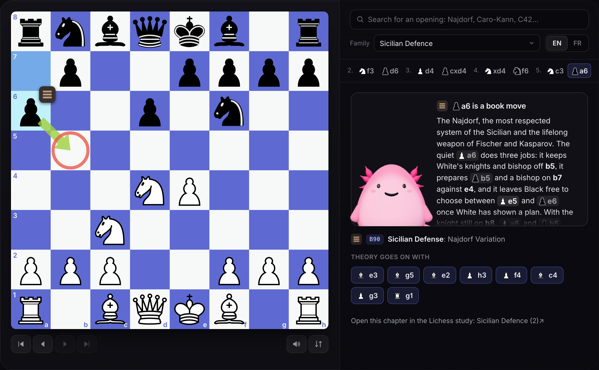
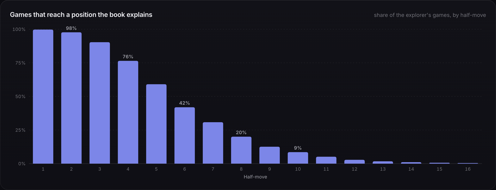
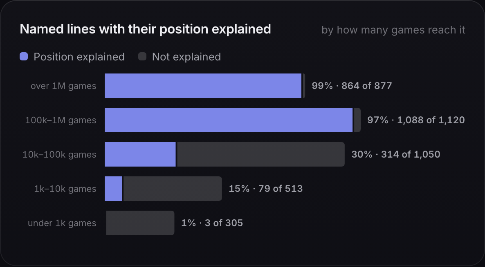
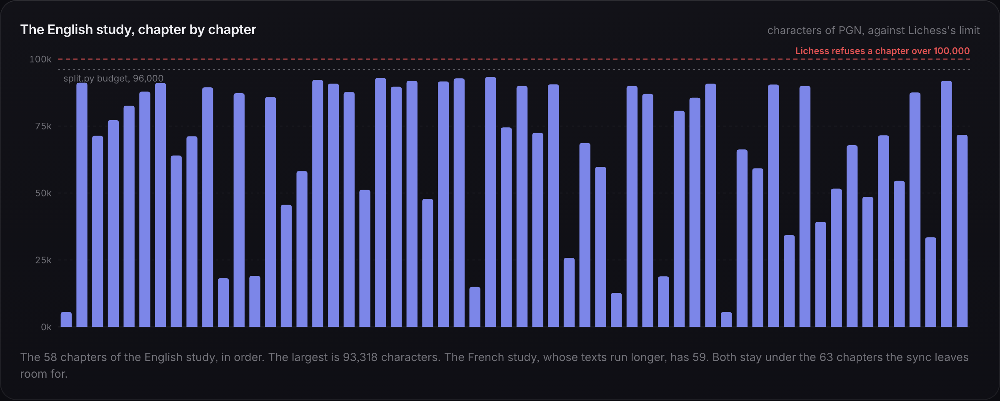

<p align="center">
  
</p>

<h1 align="center">The why behind every opening move</h1>

<p align="center">
  An open book of chess opening theory: <b>6,100 positions</b> and <b>3,338 classic mistakes</b>, explained in
  <br>English and French, every move checked on the board, and published as two public Lichess studies.
</p>

<p align="center">
  <a href="https://openings.lichessneo.com/"></a>
  <a href="https://lichess.org/study/gADVcG4j"></a>
  <a href="data/README.md"></a>
  <a href="LICENSE"></a>
</p>

<p align="center">
  <a href="https://openings.lichessneo.com/"><b>Explorer and paper</b></a> ·
  <a href="#the-book">The book</a> ·
  <a href="#what-it-covers">What it covers</a> ·
  <a href="#how-it-was-checked">Checks</a> ·
  <a href="#the-studies">The studies</a> ·
  <a href="#contributing">Contributing</a> ·
  <a href="#reproduce">Reproduce</a> ·
  <a href="#cite">Cite</a>
</p>

<a href="https://openings.lichessneo.com/"></a>

## The book

A game review knows the opening, but it rarely says what the position is about. It tells you that 3.Bc4 is a book
move, or that 3…f6 was a mistake, and moves on. This book explains why: the plans for each position, arrows showing
them, the main continuations, and the mistakes club players make there, each with the line that punishes it.

| | |
| --- | ---: |
| Positions explained (transpositions merged) | 6,100 |
| Classic mistakes, each with its punishment | 3,338 (559 `?!`, 1,954 `?`, 825 `??`) |
| Texts: each position and mistake, in English and in French | 18,876 |
| Families, one JSON file each | 34 |
| Chapters of the Lichess studies | 58 in English, 59 in French |

It was written for [Lichess Neo](https://github.com/theophile-wallez/LichessNeo)'s Game Review coach, which reads
it straight from Lichess, and it's free for anyone to read, reuse and correct.

## What it covers

The book explains the positions players actually reach. In Lichess's opening explorer (4.7 billion blitz, rapid and
classical games between players rated 1000 and up), after two moves each, three games in four are still in a
position the book explains:



Of Lichess's 3,865 named lines, 2,348 end on a position in the book, including almost all of those played more than
100,000 times:

<p align="center"></p>

The mistakes come from the same explorer. In each position reached by at least 1,000 games, every move played in at
least 2% of them was scored by Stockfish. The book names or explains 93.7% of the moves that lose 100 centipawns or
more, weighted by the games they're played in.

## How it was checked

The texts were written by language-model agents, one family at a time, from a private library of sources read side by
side: Wikibooks' *Chess Opening Theory* and Wikipedia in four languages, 3,799 public Lichess studies, 2,036
transcripts of opening courses on YouTube, public-domain books, and the explorer's counts. They were written in fresh
wording: no run of eight words matches any source. Every chapter then went through three checks:

- **On the board.** [`tools/theory.py`](tools/theory.py) replays every entry with python-chess and refuses to compile
  if anything doesn't fit: the 59,226 moves and 14,790 sequences named in the texts, the 56,207 squares, the 27,462
  arrows and circles, every mistake and the moves that punish it. Each position may appear only once in the book,
  regardless of move order, and every text must exist in both languages.
- **Against the engine.** Positional claims were checked at Stockfish depth 20 or more; every tactic, mistake and
  punishment at 22 to 24; and Lichess's cloud evaluation where it had the position at depth 30 or more.
- **By a second agent.** Each family was attacked by an independent reviewer with its own engine, reading every
  text against the board. It caught what a compiler can't, like a pin that isn't there yet or a pawn called isolated
  that is only backward.

The [paper](https://openings.lichessneo.com/#checks) gives the details, the mark thresholds and what each review
found.

## The studies

| | English | French |
| --- | --- | --- |
| Study | [Lichess Neo: Analysis](https://lichess.org/study/gADVcG4j) | [Lichess Neo : Analyse](https://lichess.org/study/nKXcgQ3x) |
| Chapters | 58 | 59 |
| Largest chapter | 93,318 characters | 92,990 characters |

Lichess rejects any chapter over 100,000 characters of PGN or 3,000 moves, and a study holds at most 64 chapters.
[`tools/split.py`](tools/split.py) splits the large families into parts, placing each comment in exactly one of them,
so the whole book fits in one study per language:



A reader downloads the study's export once, without a token, and indexes it by position, which merges transpositions
between chapters. Lichess's `Last-Modified` header turns later requests into a `304` until the study changes.

## Contributing

A correction is a pull request on a file in [`theory/`](theory): a text, a move, a mistake or a new position. The
[guide](CONTRIBUTING.md) shows the format.

1. **The check** ([`check.yml`](.github/workflows/check.yml)) compiles the book with the change, checks every move
   on the board, and lists the chapters of the live studies it would rewrite.
2. **The merge** starts the sync ([`sync-studies.yml`](.github/workflows/sync-studies.yml)):
   [`tools/study.py`](tools/study.py) compares the new PGN with both studies, chapter by chapter, and rewrites only
   the chapters that changed, in place, through `POST /api/study/{id}/{chapterId}/moves`. Chapter links stay intact.
   If the list of chapters changes, the study is rebuilt in order.
3. **The players** get the update on their next review, with no new release needed.

The sync needs one repository secret, `LICHESS_TOKEN`: a personal token from the studies' owner with the `study:write`
scope. Without that token, the sync only reports what it would change.

## Reproduce

```sh
pip install -r tools/requirements.txt
python3 tools/build.py           # about a minute: checks every chapter, writes data/ and docs/data/
python3 tools/build.py --check   # the CI's check: fails if a built file is out of date
python3 tools/study.py data --dry-run   # what a sync would change in the live studies
python3 -m http.server -d docs   # the explorer and the paper, on http://localhost:8000
```

| Path        | What it holds                                                                                          |
| ----------- | ------------------------------------------------------------------------------------------------------ |
| `theory/`   | the 34 source chapters, the files to edit                                                               |
| `data/`     | the studies' PGN, one position per line in `positions.jsonl`, and every figure ([codebook](data/README.md)) |
| `tools/`    | the compiler (`theory.py`), the splitter (`split.py`), the build, the format and the sync (`study.py`)  |
| `research/` | the explorer snapshot, Lichess's named lines and the collection scripts ([README](research/README.md))  |
| `docs/`     | the explorer and the paper, served by GitHub Pages                                                      |

The research library (transcripts, third-party studies and pages) holds other people's texts, so it stays private:
`research/` publishes only its counts.

## Cite

The code is under the [MIT license](LICENSE). The texts and the data are under
[CC BY-SA 4.0](LICENSE-DATA): parts of them adapt [Wikibooks' Chess Opening Theory](https://en.wikibooks.org/wiki/Chess_Opening_Theory)
and Wikipedia, which share that license. The opening names are Lichess's
([lichess-org/chess-openings](https://github.com/lichess-org/chess-openings), CC0). GitHub's "Cite this repository"
button reads [`CITATION.cff`](CITATION.cff), or:

```bibtex
@misc{wallez2026openings,
  author = {Wallez, Th{\'e}ophile},
  title  = {The why behind every opening move: an open, bilingual book of chess opening theory},
  year   = {2026},
  url    = {https://openings.lichessneo.com/},
  note   = {Version 1.0.0}
}
```

Not affiliated with Lichess.
